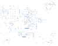

# CopperAssetTracker

LLM agents: start with `copper agent-guide` in the selected CopperScript
environment; see [the project pointer](AGENTS.md) for older compiler pins.

**A cellular, GNSS and Bluetooth asset tracker — designed as code.**

[CopperScript website](https://andenore.github.io/CopperScript/) ·
[Language and compiler](https://github.com/andenore/CopperScript) ·
[Reusable library](https://github.com/andenore/CopperLib) ·
[Current board status](docs/validation.md)

CopperAssetTracker takes CopperScript's full-vertical example into a standalone,
rechargeable hardware project: an STM32 host, LTE Cat-1 bis connectivity, GNSS,
Bluetooth and motion sensing on a six-layer board. Readable circuit intent becomes
inspectable intermediate representations, placed components, routed copper and
manufacturing review files.


*Native KiCad export of the 100 × 80 mm `prototype-preorder-v3-20261012`
manufacturing review candidate: 97 footprints, 968 routed track segments and
six copper layers. This is an unapproved prototype candidate, **not a released
production package**.*

The current figures show the exact exported PCB in the five-unit prototype
preview candidate. Its native DRC report records zero violations and zero
unconnected items, while the route summary still has **13 blocked electrical
requirement checks**. Five DRC check types were ignored, independent CAM was
skipped, and supplier availability plus assembly-preview placement review remain
incomplete. The candidate is **not approved for production or ordering**. Older
91-part checkpoints described farther below are historical intermediate
revisions, not the PCB shown in these figures.

Prototype battery choice: Kjell & Company **32058**, protected 18650, **2600 mAh**.
See [battery integration review](docs/battery-selection.md). It is an external
cell, not a JLCPCB assembly item. The separate battery revision uses a hardware
temperature window targeting roughly 5–35 °C. The combined
[91-component modem-power/battery revision](revisions/modem-power-v1/README.md) adds
CopperLib's pin-associated modem bypass bank, a wider converter output tap and
regional power distribution. ERC/placement and fresh routing checks pass;
native refill/DRC has zero violations and zero opens, with all four modem bypass
feeds verified via-free. That paragraph describes the historical 2026-10-11
checkpoint, not the latest manufacturing candidate pictured above. Temperature
guarantees, reservoir-bias derating, assembly and battery/burst-load tests remain
pending. The canonical
83-component source, release locks and older manufacturing files are unchanged;
they are not fabrication data for the illustrated 91-component revision.

## Why CopperScript?

A PCB contains more intent than wires: a capacitor protects a particular pin,
a switching converter has a critical current loop, and an RF feed needs a
reference layout and return path. CopperScript makes that intent explicit,
version-controlled and testable alongside the connections.

- **Readable hardware source:** components, peripheral selection, nets, supply
  domains and physical constraints in `.copper` files.
- **Mechanical and placement intent:** explicit poses, placement regions,
  pin-aware distance limits and routing rules, with a shared floorplan editor.
- **Reusable engineering:** CopperLib parts, footprints, regulator hard macros
  and qualification contracts instead of per-board copies.
- **Inspectable automation:** electrical IR, physical geometry, routing reports,
  native KiCad boards and assembly data at each stage.
- **Honest checkpoints:** missing connectivity and qualification evidence remain
  visible. Gerber generation is not the same as production approval.

## Three repositories, one workflow

| Repository | Owns |
| --- | --- |
| [CopperScript](https://github.com/andenore/CopperScript) | Language/compiler/ERC, mechanical editor, physical IR, constraint-driven placement/routing, KiCad export and generic assessment tools |
| [CopperLib](https://github.com/andenore/CopperLib) | Shared components, footprints, reusable circuits/hard macros, mechanical/stackup profiles and engineering contracts |
| CopperAssetTracker | This board's composition, power configuration, placement intent, exact BOM and board-specific evidence |

Generic improvements belong in CopperScript; reusable components belong in
CopperLib. This project does not fork the compiler or maintain private copies
of shared parts. The canonical composition lives in [board.copper](board.copper)
and [power_tree.copper](packages/tracker/power_tree.copper). The illustrated
revision adds [battery/charger composition](revisions/battery-v1/power_tree.copper)
and [regional distribution intent](revisions/modem-power-v1/distribution.copper).
Its source builder composes these inputs; it does not repair routed copper.

### Shared routing review

Activate a current reviewed CopperScript environment, then run:

```console
make route-review REVIEW_COPPER="python -m copperscript" REVIEW_DIR=build/review-new
```

Use a new directory. The wrapper uses the canonical 83-part source and locked
library/macro inputs with the standard bounded shared pipeline. For the
illustrated 91-part board, use [the revision guide](revisions/modem-power-v1/README.md).
[Latest validation](docs/validation.md) records each scope and exact evidence;
neither routing result approves production or advances the release pins.

## From intent to copper

```text
board.copper + CopperLib imports + pinned dependencies
        ↓ parse, resolve, elaborate and electrical checks
Electrical IR — typed components, nets and supply intent
        ↓ resolve footprints, constraints and hard macros
Physical IR — pads, placements, layers and owned geometry
        ↓ place, escape, route, repair and stitch plane contacts
KiCad PCB — native zone refill and DRC checkpoint
        ↓ export and independently review
Gerbers + drills + BOM + CPL + manifests
        ↓ RF / USB / power / CAM / assembly / prototype evidence
Production approval — a separate engineering decision
```

### Describe the circuit

These excerpts come from the generated modem-power revision's tracker source,
not a second example circuit:

```copper
import simcom "github.com/andenore/CopperLib/packages/circuits/simcom/sim7670g-vbat-bypass";
module U_MODEM: simcom.SIM7670G_VBAT_BYPASS;

configure U_MCU.USB_FS as MODEM_USB {
    DP = PA12;
    DM = PA11;
}

net V3V8 {
    PWR.V3V8;
    // Battery-fed USB detection. SIM7672X V1.01 applicability assumed by user.
    // Requires >=3.6 V at pad 24 under burst load; qualification stays open.
    U_MODEM.USB_VBUS;
    U_MODEM.VBAT_1;
    U_MODEM.VBAT_2;
    U_MODEM.VBAT_3;
    C_MODEM_BULK.1;
}
```

The hierarchical `PWR` module composes CopperLib's charger and converter parts
into this board's power tree. Compilation preserves that hierarchy; physical
elaboration resolves actual component references and footprint pads. Similarly,
`U_MODEM` composes CopperLib's modem and four pin-associated bypass capacitors;
the modem's physical reference becomes `U_MODEM/U`, without duplicating the
reusable circuit in this project.

### Give placement and routing semantic intent

```copper
component C_MCU: CAPACITOR {
    value = 100nF;
    footprint = "Capacitor_SMD:C_0402_1005Metric";
    role = decoupling;
    decouples = "U_MCU.VDD";
}

constraint copper_zone(GND) {
    id = "top-ground-return"; layers = "F.Cu";
    polygon_mm = "0.5,0.5;99.5,0.5;99.5,79.5;0.5,79.5";
    priority = 1; pad_connection = solid; island_policy = "remove_all";
    allow_same_net_hard_macro_overlap = true;
}
```

The decoupling association feeds generic pin-aware placement and short direct
surface-feed decisions; it does not forbid necessary ground-return vias. The
ground-zone permission lets compatible board/macro fills overlap without allowing
ordinary routing to rewrite immutable converter copper. Native refill still has
to establish connected fill.

### Mechanical and placement intent

The tracker's [board source](board.copper) fixes the position, rotation and front
side of connectors, modem and power assemblies, assigns the MCU a placement
region, and declares pin-aware maximum distances for bypass and RF components.
Net routing constraints also specify widths, clearances and supported layer or
pair intent. The canonical source has no mechanical outline block; the
illustrated build uses the provisional 100 × 80 mm board. These declarations
do not imply a qualified enclosure design.

For example, the canonical source keeps the GNSS antenna connection close to its
receiver:

```copper
constraint max_distance(J_GNSS, U_GNSS.RF_IN) { distance = 5mm; }
```

`make edit` opens the shared mechanical/floorplan editor with this board's pinned
compiler, six-layer configuration and hard macros. CopperScript's current
[mechanical features](https://github.com/andenore/CopperScript/blob/main/docs/mechanical-language.md)
also support source-defined outlines, cutouts, holes, slots, datums, attachments
and enclosure/access constraints. Its current
[editor](https://github.com/andenore/CopperScript/blob/main/docs/mechanical-editor.md)
supports placement previews and reviewed source saves. To evaluate features
beyond the pinned build, explicitly select a current review compiler as described
below; keep this project's release pins and evidence bindings intact.

### Inspect what the compiler understood

These component fields come from the generated electrical IR. Human-facing
values use ordinary numbers and engineering units (`100 nF`), not scientific
notation. The full IR also carries an exact SI base value for algorithms;
the decoupling properties survive compilation:

```json
{
  "footprint": "Capacitor_SMD:C_0402_1005Metric",
  "modes": {},
  "part": "CAPACITOR",
  "properties": { "decouples": "U_MCU.VDD", "role": "decoupling" },
  "ref": "C_MCU",
  "value": { "unit": "nF", "value": "100" }
}
```

The latest manufacturing candidate's native PCB export records real geometry.
This selected placement excerpt is read from that exact board file (units are
millimetres); it is not a substitute for the complete CopperScript physical IR:

```json
{
  "footprint": "CopperScript:C_0402_1005Metric__86575c98c1bd84414ad1",
  "position_mm": { "x": "53.599976", "y": "21.190002" },
  "reference": "C_MCU",
  "rotation_degrees": "90"
}
```

Browse the [electrical IR excerpt](docs/showcase/electrical-ir.excerpt.json),
[native PCB placement excerpt](docs/showcase/physical-ir.excerpt.json), and
[candidate snapshot and evidence hashes](docs/showcase/snapshot.json). These are
small excerpts, not full IR files or qualification reports. `make compile`
produces the canonical full hierarchical `build/board.json`; the revision builder
produces its own `electrical.ir.json` in the selected review directory.

### Place components and preserve reference geometry


*Placement and courtyard layers from the same 97-footprint exported candidate,
with copper omitted for readability. This is not a fresh placement run or a
photograph of assembled hardware.*

The flow combines board-specific fixed anchors, generic placement decisions,
pin-associated decoupling and rigid RF/power hard macros. Macro ownership keeps
critical relative placement and current-loop geometry intact during routing.

### Route, check and iterate


*In2.Cu regional 3.8 V distribution and signal routing, viewed from above without
mirroring. In1.Cu and In4.Cu carry ground planes; In3.Cu carries the 3.3 V zone
and a low-current modem USB-detection spur. Connectivity is checked; return-path
performance and current capacity are separate qualification gates.*



*B.Cu, also viewed from above. A single-layer image does not show every connection.*

The router is experimental. This checkpoint was reached from source through the
standard CLI's bounded placement, routing and native-feedback repair flow.
Shared CopperScript algorithms close the supply-plane contacts while preserving
protected package exits and immutable macro geometry; no project-specific
selected-net repair script is involved. The source/native guard rejects stale
pad nets, changed lands, illegal placement and altered macro geometry before a
checkpoint is reused. Success on this board is not a guarantee for every design.

Selected output from the illustrated KiCad 10.0.6 manufacturing review
candidate:

```json
{
  "component_count": 97,
  "track_count": 968,
  "via_count": 340,
  "native_drc_violation_count": 0,
  "native_unconnected_item_count": 0,
  "blocked_requirement_count": 13,
  "qualified_release": false
}
```

These routing and native DRC results do not close the remaining electrical
requirements. In particular, RF/USB impedance and return-path verification,
independent CAM, live supplier checks, assembly-placement approval and prototype
tests remain open. Zero native DRC violations is one checkpoint, not production
approval.

That last field is intentional: zero opens and DRC violations establish a useful
routing checkpoint, not RF performance, impedance, charging safety or battery USB
operation. The promise is **inspectable hardware automation**: describe intent,
reuse engineering building blocks, inspect each representation, and carry the
evidence to a real release decision.

## Engineering status and evidence

Use [latest validation](docs/validation.md) for routing status and artifact bindings,
[production plan](docs/production-plan.md) for unresolved engineering requirements,
[prototype checklist](docs/prototype-plan.md) for experimental-build acceptance,
and [assessment workflow](docs/engineering-qualification.md) for review commands.
No production order has been created.

## Hardware

- STM32G0C1RET6 host, nRF52832 BLE radio, LIS2DW12 motion sensor, MAX-M10S GNSS.
- SIMCom **SIM7670G-LNGV**, LTE **Cat-1 bis**, JLCPCB **C45935408**.
  Replaces EG800G-EU with its 24 x 24 mm / 124-land footprint and actual used-pin
  connections, 1.8 V UART/STATUS translation and open-drain PWRKEY.
- USB-C power input and **BQ24072TRGTR** 1S Li-ion power-path charger in the
  illustrated revision, with a reusable thermistor-bias circuit and timer.
- Three-pin SMT **JST XH battery connector**: 1 BAT+, 2 GND, 3 pack NTC.
- Two TPS63020DSJR buck-boost supplies: 3.3 V logic and switchable 3.8 V modem.
- Nano-SIM, two U.FL RF connectors, two SWD headers, debug UART, button/LEDs.
- Provisional 100 x 80 mm six-layer board; preserved Nordic/Johanson RF hard macro.

All 83 canonical populated references have exact candidate manufacturer part
numbers and
JLCPCB codes in [assembly.lock](assembly.lock) and
[procurement/parts.json](procurement/parts.json). The readable
[candidate BOM](procurement/candidate-bom.csv) is for sourcing, **not assembly signoff**.
The 91-part revision generates a separate candidate assembly lock; its changed
and added selections still need approval. Recheck live stock for the intended
quantity. The modem requires Standard PCBA/X-ray; see [component evidence](docs/component-evidence.md).

## Build

Install [uv](https://docs.astral.sh/uv/), Git, GNU Make and KiCad 10.
The canonical 83-part build's compiler, CopperLib and KiCad footprints are pinned
to published Git commits; these are not the newer illustrated revision's tool inputs:

| Dependency | Revision / lock |
| --- | --- |
| CopperScript | `209e4998223283923c3f1f0fb52f6fb97791cf46` in `pyproject.toml` and `uv.lock` |
| CopperLib | `f54a03b36e8a785eb512626b3f5110a7f321e37c` in `copper.mod` and `copper.lock` |
| KiCad footprints | `7ebfa6b23cc292a56f751b7b5f4a0e12eeef69dd` in `copper.mod` and `copper.lock` |

No sibling source checkout is needed and no compiler code is copied into the
project. `copper.lock` binds the complete supported-asset inventories; `uv.lock`
pins the compiler dependency. Run from this directory:

The engineering plan refers to contracts/profile files in that exact library
commit's verified `.copper-cache` directory, populated by `make fetch`.
They remain library-owned; no sibling checkout or copied contract is required.

```sh
make fetch             # online bootstrap; preserves pinned versions
make check test compile
make pcb               # placed, unrouted PCB + readiness report
make render            # front/back SVG
make edit              # shared mechanical editor
make route             # experimental full-board routing
make verify            # native KiCad refill/DRC of routed board
make power-probes      # isolated regulator macros, all cardinal rotations
make assembly          # check approved exact selections and export BOM
make manufacturing     # reviewed BOM + route + native DRC required
```

Windows: `.\build-windows.ps1 -Target fetch`, then
`.\build-windows.ps1 -Target all`; optional `-Uv` and `-KiCadCli` paths.
Default `make` checks/tests/compiles/places; it does not order anything.
These default targets build the canonical 83-part design, not the pictured
91-part revision. `make manufacturing` creates review exports and skips
independent CAM; it is not a production-approval shortcut.
Use pinned managed footprints, not a different system footprint revision;
the RF and both regulator macros' geometry identities are checked before
materialization. The reusable regulator assets are owned by CopperLib, not
this project. Their native geometry checks do not qualify power performance.

### Build and route the illustrated revision on Windows

Use a current CopperScript environment containing the native-closure changes
(commit `e6f153d20eaae6e82b9e2ee52af307129187fc7d` or newer) and the reviewed
CopperLib working copy (`df54c3f73cb833a98942d7d4ad326efd189863cb` for the pictured
checkpoint). Activate that compiler environment before these commands, from the
Tracker directory. The managed footprint cache must already be populated by
`make fetch`. Choose a new output directory for each attempt:

```powershell
python scripts/build_battery_revision.py --modem-power `
  --library-review-root ../CopperLib `
  --kicad-footprint-root .copper-cache/pkg/0c22bbbc033f71e79d6d `
  --output build/new-power-review
Set-Location build/new-power-review
python -m copperscript route-board board.copper --offline --layers 6 `
  --fab-profile jlcpcb-six-layer `
  --hard-macro nrf-antenna-macro.json --hard-macro logic-power-macro.json `
  --hard-macro modem-power-macro.json --routing-profile balanced --pitch-mm 0.5 `
  --fanout-maze --soft-ripup --constrained-pins-first --progressive-guides `
  --plane-contact-radius-mm 3 --plane-stitch-detour-mm 1.5 `
  --verify-plane-fill "C:/Program Files/KiCad/10.0/bin/kicad-cli.exe" `
  --native-evidence-directory native-new --report route-new.json `
  -o routed-new.kicad_pcb --progress
```

The first command only composes source, IR and candidate selections; the second
owns placement, routing and native verification. Use the retained **filled PCB**
identified by a successful route report's `plane_verification` evidence. A
failed/incomplete report is not a routed success. Newer tool/library inputs can
change the result; compare their recorded hashes before reusing evidence.

README illustrations and compact example data live under `docs/showcase`.
Bulky build attempts, manufacturing archives, dependency caches and downloaded
vendor PDFs remain excluded from Git. To regenerate these snapshots from a local
source-matched candidate with adjacent native `drc.json` and its matching route
report. From the Tracker directory, using the current compiler environment:

```powershell
python scripts/generate_readme_assets.py `
  --project-root build/latest-power-review-20261011 --unlocked-review `
  --pcb build/latest-power-review-20261011/native-closure-v5/verification-003/CopperAssetTracker.kicad_pcb `
  --route-report build/latest-power-review-20261011/route-closure-v5.json `
  --kicad-cli "C:/Program Files/KiCad/10.0/bin/kicad-cli.exe"
```

These are native KiCad SVG exports; `snapshot.json` records source/candidate,
composition and evidence hashes. The renderer is documentation tooling, not a
routing repair or a manufacturing export.

## Battery and firmware

Use a **protected 1S, 4.2 V maximum Li-ion/LiPo pack**, a compatible pack-mounted
10 kohm NTC and wiring rated for measured modem peaks. Verify harness pin
numbering/polarity physically: this is not a generic two-wire battery pinout.
No battery, harness, SIM, external LTE/GNSS antennas or firmware is supplied.
Do not use LiFePO4, 2S or an unprotected cell.

The charger uses USB500 mode and about 405 mA nominal charge current. Modem
bursts require the battery; USB-only operation is not qualified. PC10 enables
the modem rail, PC0 controls PWRKEY and PC1 reads translated STATUS.
Keep Nordic DC/DC disabled (LDO circuit) and tune the 32 MHz crystal loads.
USB-C is **power-only**; the MCU/modem USB pair is internal. Modem USB detection
now shares the battery-fed switched 3.8 V rail, separate from external USB-C VBUS.
SIM7672X V1.01 applicability is assumed by user instruction; voltage/transient
margin and firmware/bench operation remain unqualified. See
[battery USB implementation](docs/usb-battery-power.md).

## Release status

The current `prototype-preorder-v3-20261012` candidate has 97 physical
components and 95 fitted selections, including LTE DC blocking/tuning/ESD,
passive GNSS ESD and the selected external antennas. Its native report is bound
to the shown PCB, but 13 route requirements remain blocked; independent CAM,
GNSS/LTE coexistence and installed RF tests are still gates.

The retained 91-part revision is natively routed but remains an unlocked,
unqualified review. Native closure does not approve RF/USB impedance/returns,
biased reservoir capacitance, supply capacity/transients, battery/charger
guarantees, thermal behavior, independent CAM or prototype performance.
Battery-fed USB detection has only about 60 mV static margin before ripple and
burst effects; measure operation across the accepted envelope.

The BOM selection has user approval; that does not approve the generated CPL,
supplier substitutions, assembly preview or production release. Bind final
release inputs and complete the candidate-specific evidence before ordering.
Follow [production plan](docs/production-plan.md),
[BOM approval scope](docs/bom-approval.md) and [power design](docs/power-design.md).
